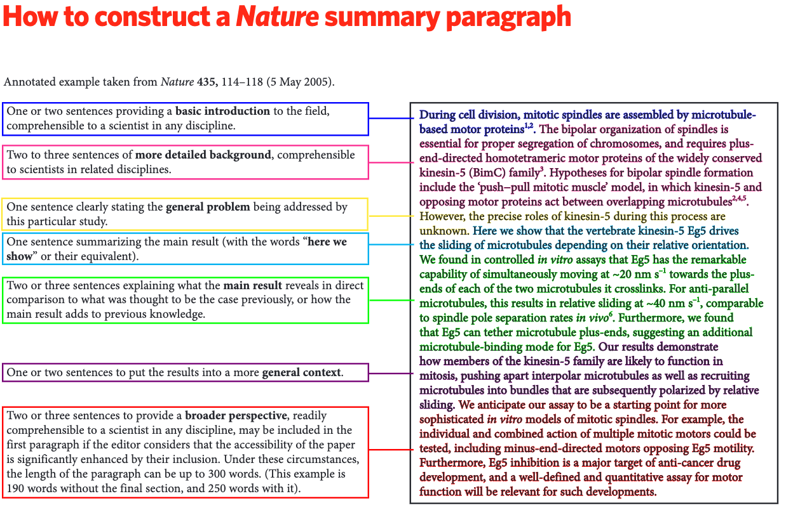
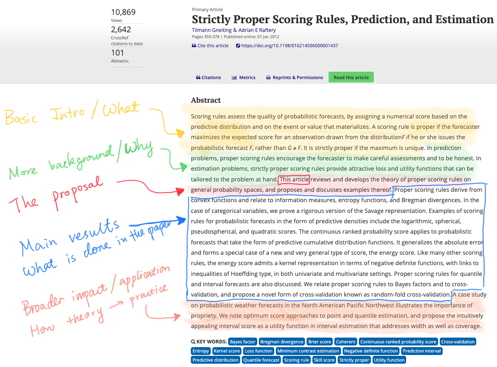
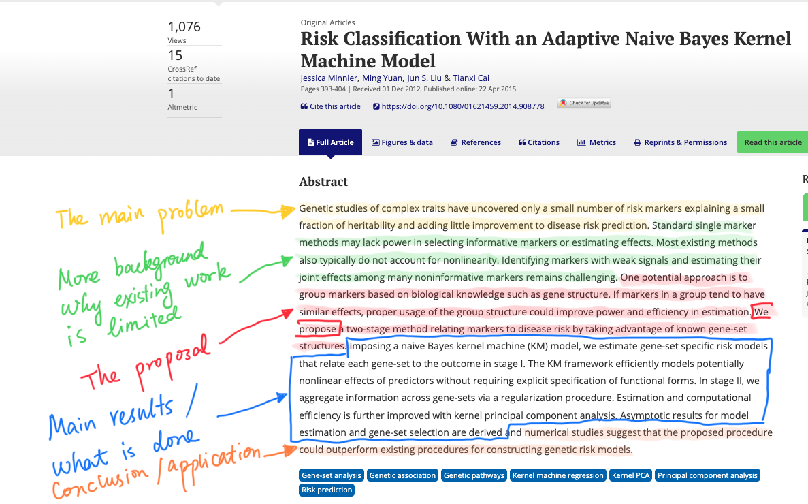

# You will write a lot, I mean, really a lot 

In academia and beyond, there is a **a lot** of writing: papers, thesis, lectures, proposals, reports, analysis plans, ...

--

Writing well helps a lot to get your papers published, your work more visible, and your arguments more convincing.

--

Can we really learn "how to write well" in an hour? Apparently not :)

--

Important topics I will not cover today include
+ Word choice
+ Grammar
+ Punctuation
+ ...

--

I will focus on a few 'big picture' principles instead. 

---
# Plan for today

1. Why do we write?
2. How do we write a statistics paper?
3. How do we write a section of the statistics paper?
4. How do we write a sentence in a section of the statistics paper?
5. Then what? Edit!
6. AI?
7. What else? Some miscellaneous topics if we have time.


---
# Writing is a struggle for everyone

### _Writing is a horrible, exhausting struggle, like a long bout of some painful illness_
.right[George Orwell (1903 – 1950) Author and Journalist]


---
# Why do we write?

--

The goal of writing anything is usually **communication**. 

--

We start with some complex ideas, data analysis, years of messing around some combinations of math, theorems, computer codes, data insights, nuances, ...

--

We need to turn them into understandable summaries that are 
+ accessible
+ actionable 
+ clear and precise
+ transparent and trustable


--

What is missing?

--

All the above are relative to what the **target audience** is. So always be clear about: <span style="color:royalblue">who am I writing this to, and who might want to read what I write!</span>


---
# How do we write well?

--

#### _Learn as much by writing as by reading_
.right[Baron John Acton (1834–1902) Historian and Moralist]

--

#### _Easy reading is damn hard writing_
.right[Nathaniel Hawthorne (1804 -- 1864) Novelist]

--

###<span style="color:royalblue"> The best way to learn how to write well is through reading and reflecting on what you read.</span>


---
# How do academic papers communicate: the typical story arc

Let's take statistics papers as an example. How do statistics papers usually communicate?

--

Statistics paper are usually structured into Abstract -> Introduction -> Methods -> Evaluations -> Discussion.

--

**Introduction**: what you want your reader to know

--

Clear context and motivation: what problem you are addressing and why it is important. It may include both a scientific problem and statistical problems.

--

Literature review: what has been done now and how are they related to your work.

--

Your proposal: what you did and how does it contribute to the field.

--

<span style="color:red">Write as if you are reading: </span> would I be interested in keep reading the paper?

--

<span style="color:royalblue">Practically: </span> I usually write the introduction early to clear my mind on what I want to write in the paper, repeatedly edit it, and usually finish the section at the very end of the writing process. 


---
# How do academic papers communicate: the typical story arc

--

**Methods section(s)**: 

+ You probably spend most of the time developing the technical aspect of this section. But you effort and word count are likely not proportional. 

--

+ Often the section(s) consist of the main outline of methods. Many details may be left to the appendix. 

--

+ The section(s) need to be self-contained with clear notations established, assumptions stated, and model choice justified. Do not assume your readers think the same way as you and use the same notations by default. 

--

+ When the method is complicated and layered, the method section(s) may need a story arc (just like when organizing the paper) for readers to follow.  


---
# How do academic papers communicate: the typical story arc

**Result section(s)**: 

--
+ Structure the results logically 
+ Demonstrate validity
+ Demonstrate comparisons
+ Highlight scientific importance and interpretations


--

**Discussion**: 

--

+ Summarize your work: imagine your reader skip directly to here after reading the title.
+ Summarize your contributions and what new insights you bring.
+ Discuss limitations.

--

<span style="color:royalblue">Practically: </span> I usually formally write the discussions last, but I keep track of the limitations that I would like to discuss here throughout the writing process. 


---
# Take-home message

A good analysis, theorem, or model $\neq$ a good paper.

--

A paper needs to have a story arc:  There should be a problem, reasons why some solutions are unsuccessful, and a solution that you can recommend (potentially with caveats).


```{r echo = FALSE, out.width = "50%", fig.align = 'center'}

```

--

<span style="color:royalblue">And the story needs to be told with the audience in mind!</span> 

---
# There should be stories within stories

```{r echo = FALSE, out.width = "70%", fig.align = 'center'}

```


---
# Zoom in: take the abstract for example

```{r echo = FALSE, out.width = "100%", fig.align = 'center'}

```


---
# Statistics abstract example 1

```{r echo = FALSE, out.width = "100%", fig.align = 'center'}

```


---
# Statistics abstract example 2

```{r echo = FALSE, out.width = "100%", fig.align = 'center'}

```

---
# More generally in storytelling


The general considerations of storytelling holds in all sections of the paper

- Why are you writing this? Does it have a point?
--

- What is the sequence of ideas you want to tell the reader? <span style="color:royalblue">This is usually different from how you arrive at the paper's current contents.</span>
--

- Will the reader be interested/curious when reading this?
--

- Use minimalism to achieve clarity: Can the points be conveyed just as well without X?
--

- Is this something for a new paragraph? In general, try to avoid combining multiple major points in one paragraph.

--

It is impossible to define a specific formula for writing scientific papers. The meat of the paper can have many flavors, but the general principles largely hold. 


---
# Stories within stories within stories

Similarly, when constructing sentences, think of them as mini-stories. For example, 

* Instead of: _The promise of our new approach is reduction of bias._
* Try: _Our new approach promises to reduce bias._

--

#### Principles of clarity
* Make main character subjects.
* Make important actions verbs.
* Go to your point quickly.


---
# Edit, edit, edit


### _Every single word that I publish, I write at least six times_
.right[Paul Halmos, Author, 'How to write mathematics']

#### Editing matters
--

+ If an explanation _sort-of_ works to you, your reader will be totally lost.

--

- If a word does not convey a precise meaning, it will be misinterpreted or your audience won't trust you. E.g., _worked quite well_ or _had X% better accuracy than_, _did not work_ or _failed to converge_.


--
+ Catching your own errors is hard. Reading sections aloud may help. 
+ Version control your writing
+ Get someone to read through your writing.
  
---
# Edit, edit, but do I still need to edit?

#### Editing takes time: 
The return of repeated editing diminish eventually, but you probably have a deadline before then.  Insufficient editing is obvious and unimpressive. But over-editing is common!


--
My strategy is to first write everything I have in mind down, before fine tuning each sentence in the introduction to make them perfectly fit in their boxes (unless I really feel the urge to do that). 

You should develop your own strategy that works for you. 


---
# Writing with AI: what changes?

AI makes it cheap to produce fluent sentences, generate alternatives, and revise repeatedly.

--

But fluency is not judgment. The difficult decisions remain:
+ What is the claim?
+ Who is the audience?
+ What evidence supports the claim?
+ How strong can the conclusion be?

--

A polished paragraph can still hide a weak argument, a changed inferential target, or an unsupported logic fallacy.

--

<span style="color:royalblue">Use AI to shorten the path from rough thought to careful prose, not to skip the thinking.</span>


---
# How do I talk to an AI agent

Which of the following is better?

_Write a paragraph on asymptotic variance_.

_Make this paragraph better_.

_Do not rewrite this paragraph yet. Identify its main claim, supporting evidence, unstated warrant, and weakest transition. Preserve the notation and do not create new claims. Summarize the assessment, and provide two/three alternatives on what to change._

--

In general, think like an editor and treat AI as your junior writer. Make sure you are on the same page with
+ the audience and purpose
+ the main claim
+ what must remain unchanged
+ the problem you want diagnosed


---
# Use AI in separate passes

1. **Frame:** Write down the intended claim and the paragraph's job.

--

2. **Diagnose:** Ask AI to map the argument before changing the prose.

--

3. **Revise:** Request focused alternatives for structure, wording, or transitions.

--

4. **Audit:** Check facts, mathematics, citations, notation, and claim strength.


--

<span style="color:royalblue">Separate passes make errors easier to see and revisions easier to evaluate.</span>


---
# Your writing should have your voice

Some real examples:
--

* _The model relies on two assumptions that can impact estimates of small domains if violated._
* _The model rests on two assumptions, neither of which affects consistency, but both bite in the
small domains that borrow the most if violated._

--

* _Every estimator reports a point estimate and a 95% interval._
* _We report the point estimate and 95% interval for every estimator._

--

* _Coverage checks calibration alone, and an estimator can game it with
wide intervals, so we also report the interval score._
* _We also report interval scores that evaluate both the coverage and width of the estimated intervals._


---
# Your writing should have your voice


* _Our diagnostic is applied before the test label is observed_.
* _We apply our diagnostics before revealing the test labels_.

--

* _Health records often contain narrative or other unstructured evidence that was not used by the primary prediction rule but that an expert would inspect when judging whether a proposed output is plausible._
* _For many predictive tasks, the full health records often contain unstructured evidence, such as narratives, that is not used by the primary prediction algorithms. Such information, however, is usually informative for expert to inspect and audit the algorithm predictions._

--

<span style="color:royalblue">You should have an identity in your own writing. No one will take your writing seriously if it is clearly AI-speak (and yes, it's very easy to tell!)</span>


---
# Use AI as a skeptical reader

After a draft exists, ask AI to look for specific problems:

--

+ Which quantity appears before it is defined?
+ Any inconsistent notations?
+ Is the writing style consistent?
+ Are texts, equations, and plots consistent with each other?
+ Which claims need more evidence or a citation?
+ What would a skeptical reviewer challenge or misunderstand?
+ Suppose you are Bruno (read the overall research profiles and some representative work from Bruno), what would you think of the paper?

--

<span style="color:red">Ask for a diagnosis first. Decide what is truly a problem before asking AI to repair the text.</span>

 
---
# Teach AI the rules of the project

Keep a short, revisable project style file with:
+ preferred terminology and notation
+ rules for authorial agency
+ claims that must not be overstated
+ citation and capitalization conventions
+ recurring problems to avoid
+ rules for targeted edits versus full sweep of the whole document (especially when working on large projects)

--

<span style="color:royalblue">With the efficiency gain from AI, you should edit your writing more, rather than less.</span>
 
 
---
# Main takeaways
1. Do not be afraid of writing.
1. Know your audience.
1. Write to tell a story: within a sentence, paragraph, section, and paper.
1. Be formal, precise, and clear.
1. Edit your writing.
1. Use AI to diagnose and iterate following the same principle, but keep responsibility for your own writing.
 


---
# Misc topic: Writing technical materials

In general, rules of formal writing apply.

--

Even in math-y materials, everything should be in complete sentences.
- Bad:    Consider $\hat\theta_n, n > p$.
- Good:   Consider $\hat\theta_n$, where $n > p$.
- Better: Consider the estimator $\hat\theta_n$, where $n > p$.

--

Be precise with words:
- principle components or principal components
- causal or casual
- the 'statistical' meaning vs the 'lay' meaning: confidence, consistent, robust, profile, ... 

--

Show the relevant information:
- graphics with clear annotations.
- explain what is in the table/figure in captions.

---
# Misc topic:  LaTeX 

LaTeX is a software system for document preparation.
	
--

- [Overleaf](https://www.overleaf.com/) is a useful place to start.

--
- My setup: [Sublime Text](https://www.sublimetext.com/) + [LaTeXTools](https://latextools.readthedocs.io/en/latest/). 

--
- Using a [Makefile](https://github.com/richardli/Writing-intro/blob/master/tex-examples/Makefile) from command line.

--
- There are many other editors.

--
- Use BibTex to manage your references.

---
# Misc topic:  Reproducible research

The purpose of research is not just solving a problem, but to teach people how to solve similar problems. 

--

A good research paper should contain enough information to allow an informed reader to reproduce/verify the results.
--

- proofs
- implementable algorithms and parameter settings
- data or how to obtain the data (whenever possible)

--

Informal documents can usually also benefit greatly from reproducibility.

--

What's the benefit for _you_?
- You usually need to re-run your analysis or re-visit some parts of the project in the future. 
- You can more easily recycle re-useable parts for the future.
- Collaborators like you more!

---
# Misc topic: Writing + analysis workflow

--
Always make sure you can reproduce results, and that you can easily let others reproduce them.

--
Some specific recommendations:
+ Use relative paths. Check out R package [here](https://here.r-lib.org/).
+ Set seed.
+ Comment your codes in structured way. Check out syntax of [roxygen2](https://roxygen2.r-lib.org/).
+ Follow a style guide in coding, tidy your codes manually or with `Tidy = TRUE`.
+ Use `session_info()` to document package versions.
+ Use README file to give instructions (package versions, directory structures, any additional dependencies).


--
Version control your code and documents with Git. You can use a local workflow for yourself. If you need to collaborate with others, Git becomes more essential. 

My past STAT 200 Git tutorial is [here](https://github.com/richardli/Git-Intro).


---
# Misc topic: Writing + analysis workflow

.center[It is a pain to code, experiment, and document your experiments.

But there is also great benefit!]


---
# Additional resources

#### Writing scientific papers
+ [Writing Technical Papers or Reports (Ehrenberg, 1982)](https://www.jstor.org/stable/2683079)
+ [The Science of Scientific Writing (Gopen and Swan, 1990)](https://www.jstor.org/stable/29774235)
+ [Novelist Cormac McCarthy's tips on how to write a great science paper (Savage and Yeh, 2019)](https://www.nature.com/articles/d41586-019-02918-5)
+[Jennifer Raft's note on reading and writing scientific papers](https://arc.duke.edu/how-to-read-and-understand-a-scientific-paper-a-guide-for-non-scientists/)
+ [John Lee's notes on writing mathematics](https://sites.math.washington.edu/~lee/Courses/583-2005/writing.pdf)
+ [Andrew Gelman's advice on two articles](https://statmodeling.stat.columbia.edu/2009/07/30/advice_on_writi/)
 
#### Reproducibility and R Markdown
+ [Coursera Course on Reproducible Research (free) by Roger Peng, Jeff Leak, and Brian Caffo](https://www.coursera.org/learn/reproducible-research)
+ [Reproducible Research: A Retrospective (Peng and Hicks, 2020)](https://arxiv.org/abs/2007.12210)
+ [R Markdown tutorial from RStudio](https://rmarkdown.rstudio.com/lesson-1.html)
+ [R Markdown Cheat Sheet](https://rstudio.com/wp-content/uploads/2015/02/rmarkdown-cheatsheet.pdf)
+ [R Markdown: the Definitive Guide (Xie et al. 2020)](https://bookdown.org/yihui/rmarkdown/)

---
# Today's slides
<br>
<br>
.center[
####[https://zehangli.com/teaching/Writing-intro/Writing-for-statisticians.html](https://zehangli.com/teaching/Writing-intro/Writing-for-statisticians.html)
]

<br>
Source repository:

.center[
####[https://github.com/richardli/Writing-intro](https://github.com/richardli/Writing-intro)
]
